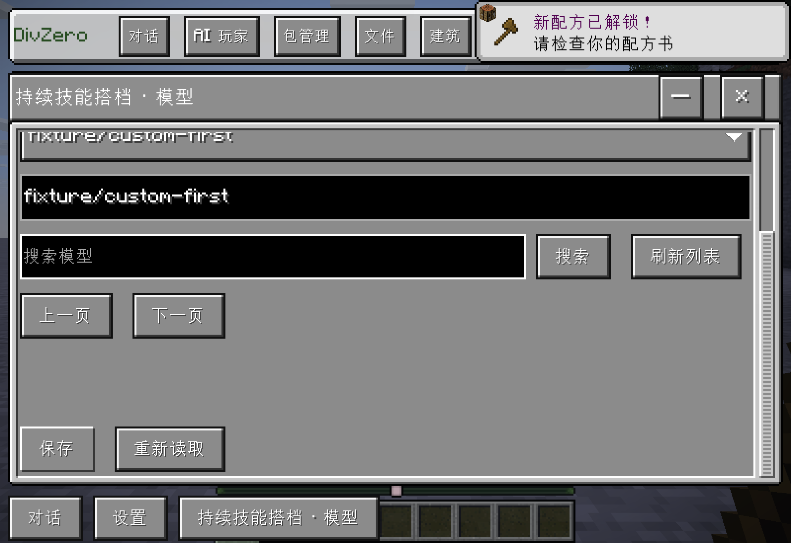
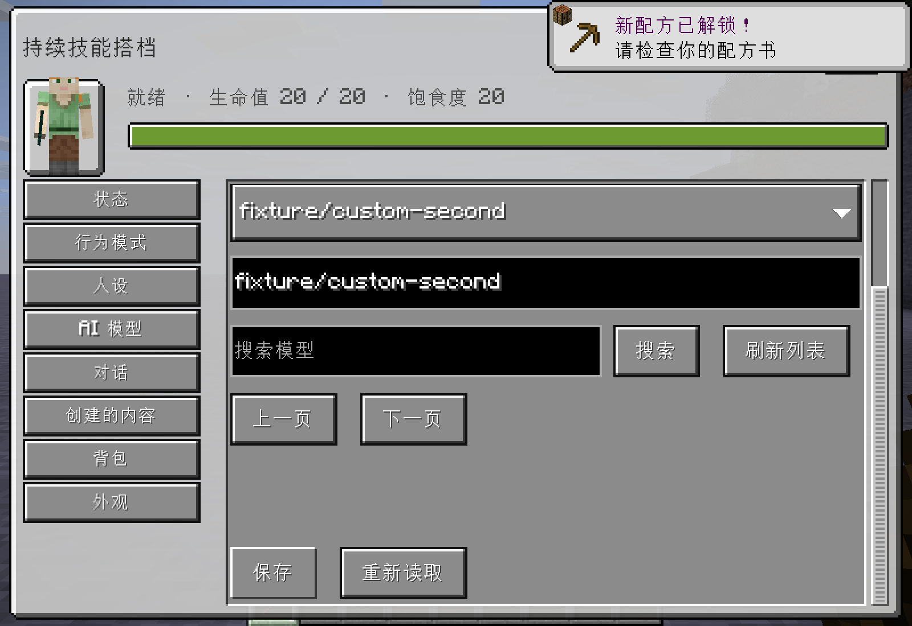

# 原生事件能力、模型与 Python 界面优化（1.0.34 候选）

本批先完成通用事件能力，船的驾驶、WASD 和空格加速留作后续示例。

## 实现

- 复用原生交互规则，引入无目标的可复用能力模板与独立绑定。新事件包括物品使用、开始/完成使用、跳跃、受伤、死亡观察；支持实际效果、速度增量、伤害比例与使用时长。模板更新、停用与解绑统一使用所有者、世界及版本校验，失败保留旧版本。不能取消的事件明确拒绝取消要求，不宣称任意原版/第三方代码均已适配。
- 新工具只随 rules 能力组按需加载，普通聊天不增加常驻工具。能力模板及其规则绑定可在包管理查看。
- 自定义网格及碰撞每轴上限为 100 格，保留顶点/三角预算。RGB/RGBA 整数数组及原十六进制颜色均可使用。生物及骨骼支持文件库 PNG，沿用资源哈希、分块传输与客户端贴图缓存。PNG 最大 1024×1024、1 MiB；不是无限模型预算。手持物品的展示缩放沿用其独立契约。
- Python 同一请求的确认、进度和结果在同一条聊天记录原位更新。查看代码提供“返回”，只收起该请求产生的代码消息。
- 已准备的 Python 环境仅检查所属目录与必要文件存在，不逐次计算整个环境的哈希。首次仍离线解压和完整校验。设置 → 更多设置提供退出后修复，隔离旧环境并保留工作目录。
- 设置 → AI 玩家模型逐个配置；AI 专属面板也有 AI 模型标签。默认继承或自定义名称沿用现有独立模型路由、版本与权限检查。

## 验证状态

最终候选源码：`be10ea13e5b40da7ae1826c2e3371aa85616c3f0`。两种 Python 版本均通过 [Actions 42235602935](https://github.com/gaoshanliuni/divzero/actions/runs/42235602935) 的编译、包含的单元测试、双版本内容检查及打包检查。

隔离实机验证通过：

| 检查 | 实际结果 |
| --- | --- |
| 原生跳跃 | 真正触发配置的状态效果 |
| 伤害修改 | 原生 4 点伤害经倍率 0.5 后实际扣除 2 点生命；解绑后恢复扣除 4 点 |
| 物品使用时长 | 原生开始使用物品后的剩余时长为配置的 8 Tick |
| 候选错误与版本 | 错误动作返回 `on_allowed[0]` 具体原因和 NOT_STARTED，原版本继续保留 |
| 生命周期与兼容 | 停用不再触发，解绑恢复原生处理，原钥匙规则仍能阻断并正确放行 |
| 生物/骨骼 PNG | 根模型及骨骼资源绑定、哈希下载、GPU 贴图实际绘制通过 |
| 两处模型设置 | UI 尺寸 4 下通过可见保存按钮分别写入两个列表外模型 ID，并从服务端独立读回 |
| Python 消息 | 代码展开、返回收起通过；确认、准备、执行和结果只有一条 Python 状态记录 |
| Python 环境与修复 | 初次离线运行固定库成功；第二次不做全库哈希，实际库导入错误正常返回；退出后修复与同世界重新进入后运行均成功，用户文件保留 |

事件、贴图、界面证据来自 `build/native-ui-runtime/fcffa36c-44b2-4e2d-8ade-1b13576addd1/game/`。Python 实机证据来自 `build/native-ui-runtime/cc70e6c3-5d69-4e71-bc99-d05c83b309dc/game/` 的初次与 resume 报告。Python 实机基础包来自 Actions 42231052851；最终内置包的 29 个 Python、维护和相关聊天接口类与该实测包逐字节一致，另有最终双版本 CI 验证。

模型目录采用受控本地 HTTP 接口，只返回测试列表；没有调用真实模型推理服务，付费模型调用为 0。100 格边界、超限拒绝、RGB/RGBA 和骨骼累积边界通过单元测试；未将这些证据扩展为任意第三方 Mod 事件或多人组合均已验收。

### 保留的失败记录

- 最初构建缺少新版本候选说明，补齐后进入编译；后续旧测试仍把合法 RGB 数组当作错误，改为验证越界 RGB 值。
- 第一轮 Native 发现候选参数错误被包装为 UNKNOWN，已修正为确定未执行的具体错误；持久化结果未知仍保留原保护。
- 后两次界面 fixture 分别漏了新世界客户端启用、模型服务配置前提，修复 fixture 后完整复测通过。未配置 API 地址时的原始英文错误也改为中文指引。

候选交付目录为 `build/delivery/event-model-python-1.0.34/`，包含两份 JAR、SHA256SUMS、使用说明和验证回执。当前没有发布新的 Release，也没有安装到正式游戏目录；现有 1.0.33 主包、生产世界、配置与学习权重保持原样。

## 界面截图

截图为 UI 尺寸 4，已滚动到模型输入和保存区域；`fixture/custom-*` 是专门验证列表外名称的测试 ID，不代表真实模型服务。

