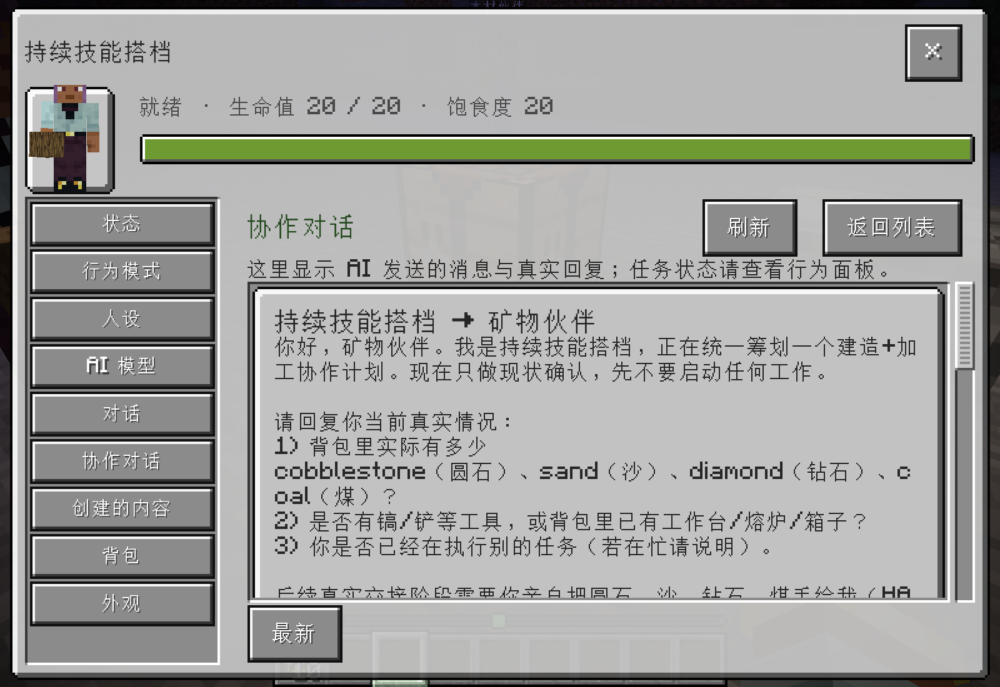
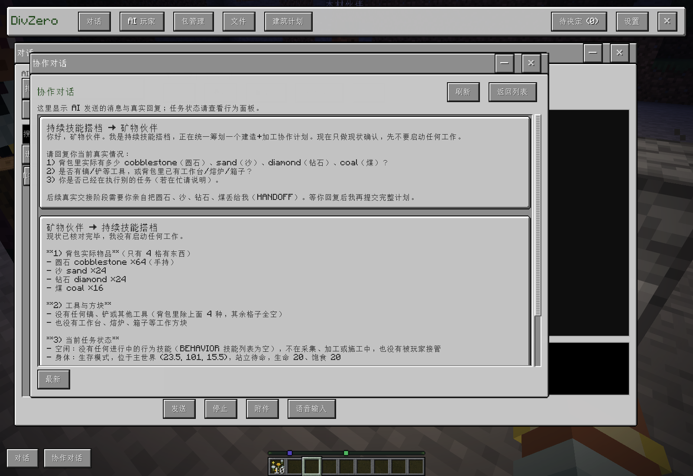
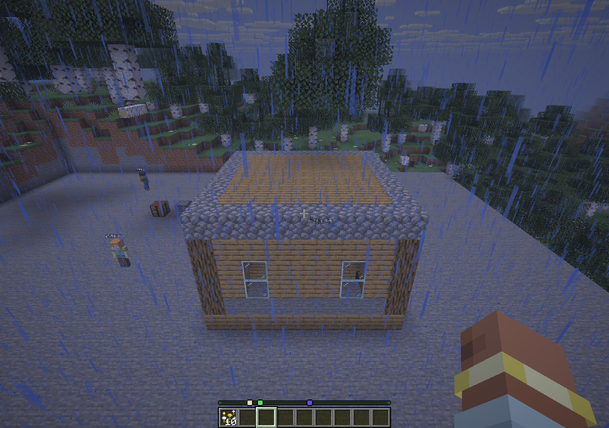

# 配方加工与 AI 协作对话

2026-11-08：本次配方加工、真实 AI 协作聊天及模型生成房屋的原生施工/入箱联合验证已通过。更早的资源升级整批尚未全部收尾，候选未安装到正式实例，未发布 Release。

## 真实配方与原生加工

`inspect_recipes` 读取当前服务器的真实配方，包括已注册的模组合成、熔炉、高炉和烟熏炉配方；返回配方引用、工作站、输出定义、烧制刻数及材料候选。查询精确配方 ID 优先，刻意搜索材料用途时使用 `match=any`。重复材料按所需槽位合并，避免把多个可替代材料误当成全部必需。

`process_items` 将加工交给本地持续执行：工作台使用原生配方/菜单操作，熔炉投入真实原料和燃料并等待实际烧制，储存通过真实容器槽位转移。每一步核对物品变化并保存操作回执；缺料、缺燃料、箱满等进入相应等待，已提交但结果不确定的写入不重放。可以把加工接到采集、交接、施工、入箱的协作依赖中。

独立原生验收已覆盖原木→木板→木棍/箱子、24 钻石→完整四件盔甲、圆石→石头、沙→玻璃，以及真实制作并放置箱子、将四件盔甲存入槽位。已存在的箱子及其物品受到保护，不因后续施工被覆盖。

## 查看真实 AI 对话

`send_peer_message` 让同一玩家的两个 AI 通过各自配置的模型和工具交换消息。发送与回复持久保存到普通会话存储，并记录双方身份；调度状态与对话正文分别展示。双方 AI 的专属面板和 F2 都有“协作对话”入口，支持列表、分页、查看消息、继续展开、刷新和返回列表。

运行 `d798f223`（公开源码 `49b665e6`）已实际点击并读取真实 DeepSeek 会话。专属面板在 UI 尺寸 4、F2 在尺寸 2 下通过，顶部刷新和返回按钮均实际点击验证。

## 真实 DeepSeek 验证边界

运行 `a6522beb` 的 19 次官方 `deepseek-flash` 请求全部完成，使用 high thinking，不设置人工输出 token 上限。模型自行向两名同伴确认库存、查询配方、根据具体字段诊断修正建筑计划，并提交 19 节点协作计划。调用使用 549,611 个输入 token、44,544 个输出 token，其中输入缓存命中 426,880；密钥和原始私有审计不公开。

两名同伴实际完成五次材料交接，本地程序完成 52 次木板配方、木棍、箱子、四件盔甲、27 个石头和 16 个玻璃的加工。模型生成的房屋为 `partner_cabin` 第 2 版，289 个目标方块、14 项实际验证条件。早期执行器问题的失败场景均保留；后续使用原模型计划和已完成加工结果验证修复，不重复付费生成，也不重放已完成的交接/加工。

完整恢复运行 `b030521a` / 公开源码 `2c978437` / Actions `42436355925` 已通过。房屋实际尺寸为 9×9，包含 81 个地板方块、126 个墙体方块、81 个屋顶方块和 1 个箱子。全部 289 个目标方块均有原生放置回执，材料实际消耗 289 件；没有未确认的放置记录。

建筑账本确认第 2 版已生效且 `VERIFIED`，14 项检查全部通过，实际观察在本次最后修改之后完成，覆盖 289 个变化位置，没有状态差异。检查包含构件尺寸、地板支撑、室内净空、门洞、入口通路、窗户、石料基座、墙角柱和屋顶。

世界实际读回 197 个橡木木板、27 个石头、16 个玻璃，箱内为钻石头盔、胸甲、护腿、靴子各 1 件；19 个协作节点全部完成。该恢复场景沿用原 DeepSeek 方案和已加工的真实物品，新增模型调用为 0。施工/储存采用和平难度隔离夜间战斗，AI 仍为生存身体；不能把它当作战斗中施工的验收。

截图为完成后的原生画面，天气未后期修改。初次付费规划和中途施工失败证据继续保留；通过结果不覆盖失败记录。
