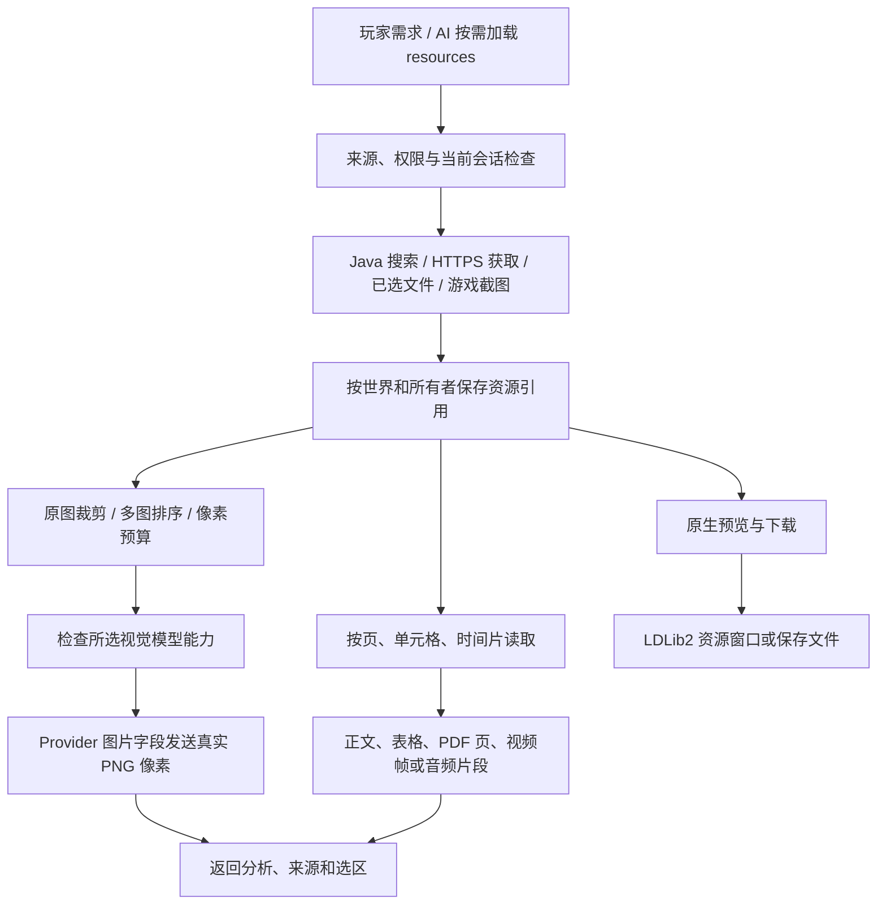

# 资源、视觉、混合记忆与多 AI 协作升级（进行中）

2026-11-07 用户授权：完成本批全部功能后发布 GitHub Release，并替换正式实例主包。

## 最新验证状态（2026-11-07）

公开 Actions **42378784286、42379074151 均已成功**：NeoForge 编译，所选 core/脚本/Worker/client/agent/UI/YSM 回归及隔离候选 JAR 打包通过。包括多图 HTTP 实际字节、分层消息、服务失败不重试、事件/调度/分发/包复制的旧身份与版本约束、协作历史分页以及蓝图字节观察。下文各次失败是保留的历史记录，不代表仍在失败。整批尚未完成；正式主包仍为 1.0.33-with-python，尚未发布 1.0.35。

## 已确认范围

1. 移除 DivZero 主动计算的文件/内容摘要和重复校验，以资源 ID、版本、直接比较替代；Java 集合、Git、HTTPS、第三方库不可避免的内部机制保留。禁止用常量假冒校验通过。迁移时保留旧存储可读及权限、版本、来源隔离。
2. 统一网页、图片、PDF、音视频、表格等资源搜索/读取/预览/下载，Java 管理；这些操作不走 Python 执行确认。
3. 多图视觉输入、inspect_image/compare_images、裁剪、细节、玩家图片、在线图片、原生截图和模型渲染结果。
4. 分页/按单元格/视频帧/音频片段解析，不只返回名称或摘要；动态网页按实际可读能力报告。
5. 真正的关键词与语义向量混合检索，保留世界、玩家、AI 和不同记忆类别的隔离、来源和时间。
6. 模型能力元数据、显式配置和按需探测；可选游戏截图。
7. 同一所有者 A/B/C 持久协作：B 采木、C 采石，真实携带、丢给 A、A 拾取后建屋；不足再次分派，任务依赖/资源预留/阶段交接/停止都可查询。

## 资源查阅链路

这些步骤不会进入 Python 执行确认。视频的受支持编码可由 Java 处理，其他编码使用捆绑的 FFmpeg；音频转写和图片分析分别需要已配置的识别/视觉服务。截图需要玩家开启，密钥输入界面禁止截取。下载、返回元数据或把像素发出，都不单独代表模型已正确理解内容。

## 当前实现与验证边界

本批候选版本为 1.0.35，尚未发布或安装。已接入 Java 资源库、资源工具、多图视觉传输、原生预览与可选截图、模型能力配置、实际向量接口和分域语义索引。Python/媒体安装及 Release 脚本已迁移到明确版本和文件元数据，不计算自有文件摘要。旧命名空间只在用户批准的迁移入口派生一次并持久保存。

图片选择以原图像素坐标裁剪，最多 8 张、合计 16 MiB；像素通过模型图像字段传输，文本历史只保存资源引用和分析。PDF 可读页、渲染页面及提取带位置的表格；表格推断保留不确定性，不能当作精确 OCR。HTML 合并单元格展开；XLSX 不执行公式。视频先用 Java 解码，无法处理的编码由 Java 管理的捆绑 FFmpeg 解码。音频分段转写需要配置独立识别服务。

语义检索在设置中指定真实 embeddings 模型后启用；未配置时明确使用关键词检索。记忆保存后异步建立索引，查询等待向量最多 1.5 秒，超时使用关键词结果。向量按世界、玩家、AI、模型和记忆版本隔离；更新、忘记或切换模型后，旧向量不再用于该版本召回。

公开 Actions 42344768425、42345181760 已通过 NeoForge 源码编译与相应专项测试。早期 42330830277 的语义索引命名空间过长、42332818351 的资源根目录规范化，以及 42343391310 的施工方块解析异常声明问题均已修复；失败记录保留。测试涵盖迁移隔离、同 ID 并发写冲突、记忆版本和作用域、实际 PNG 裁剪、PDF 页面、合并表格、XLSX、PCM 片段、聊天摘要、Python 旧目录定位和协作计划契约。这些证据不代表游戏内联验已完成。

## 续作：原生施工和持久协作

新增 `construct_building`，与 `gather_resources`、`handoff_items` 共用技能调度、身体控制、导航、实际物品操作和战斗打断。施工绑定保存的建筑 ID 和版本，读取实际方块，保护既有方块实体和受限地形，真实挖掘/放置并核对物品消耗；缺材料进入等待。每次写入前保存操作记录，未知结果不能自动重放。施工后沿用原建筑验证器检查状态、门洞、通路与尺寸。

新增渐进披露的 `cooperation` 能力组：`start_cooperation` 保存节点依赖，`inspect_cooperation` 查询阶段与子操作回执，`control_cooperation` 暂停、恢复和停止。一个身体同一时间只执行一个节点，不抢占已有工作；不同成员可并行。成员必须属于同一真实玩家，不能借协作接管真人或绕过原有权限。完成判断等待子技能的持久化回执，不以提交成功代替完成。

`supplies` 将采集、交接和施工节点关联起来：只有上一轮采集/交接已实际完成、施工明确缺少对应物品时，才以新操作 ID 发起补给轮次。玩家停止成员、新工作改变控制权、权限变化或未确认的子操作会阻止旧计划继续派发。重启保留依赖、轮次和回执，先暂停核对，不重放旧动作。

已添加隔离原生场景 `mineagent.skillSmokeMode=cooperative_building`：A 背包为空，B/C 只有采集工具，从实际原木/石头取材；每次仅交接 4 件，目标小屋需要 14 原木和 18 圆石，故必须二次补给；核对指定接收者拾取、32 次真实放置及门洞/通路/屋顶。**该场景尚未执行，不能计为已通过的实际建造证据。**

## 续作：去除摘要校验的兼容处理

聊天请求、界面事件、语音请求和无进展检测改为比较实际请求快照。历史摘要使用消息 ID、版本、偏移及原文片段验证；旧记录可从已保存的提示词取回原文进行比较，不重新计算内容摘要。原生 @ 会话只在发现旧记录时，按授权的一次迁移方式定位旧 ID 并保存映射。

Python 目录现在依据持久映射和原有 `game.owner` 找回已安装环境；首次定位后缓存路径，不再每次摘要化游戏路径。原生容器、方块状态和合成库存使用有容量边界的观察 ID，底层保存实际状态供直接比较；ID 失效时需要重新观察，不能冒充内容校验。面板签名入口已经与完整 Ed25519 公钥 ID 对齐，仍校验实际签名。

`CodeDraftService.storeSource` 的源文件 ID 不匹配已经修复。主文件、源文件集、编译请求与回执现在绑定明确版本，旧草稿保留原引用并迁移；同一源文件集再次提交时比较准确内容。公开 Actions 42351515354 已验证这一批次，不再沿用旧接续记录中“尚未开始”的状态。

仍需完成：全仓剩余摘要调用及其历史数据兼容审查、内容包/编译观察等剩余引用链路、上述多 AI 场景的实际运行与纠错、资源与模型能力的原生联验、完整双版本构建和最终发布安装。源码与契约测试通过不能代替这些完成条件。上一轮 1.0.34 候选未安装/发布，本批交付需包含其已完成改动；当前仍不应安装或发布半成品 1.0.35。

## 2026-11-07 接续实现与原生结果

公开 Actions 42358119118、42358377795 均通过源码编译、所选契约回归及隔离候选 JAR 打包。修复后的内容包资源读取、世界代码修复上下文、数据包/客户端资源包实际加载验证使用签名资源字节；编译依赖回执比较有界的完整版本元数据。编译输入复制到独立文件，按捕获时的准确字节检查变化，不再使用可共同被修改的硬链接。

客户端发布者 ID 按服务器和公钥身份持久保存，脚本与资源包共用；已记录的旧文件命名 ID 可直接采用。界面状态按世界、玩家、包、页面和目标隔离，旧状态仅在首次定位时派生旧作用域 ID 并保存映射，保留已有 revision。Acorn 从捆绑资源读取且检查可用性和大小，不再重复计算文件摘要。

截图传输使用 capture/version ID、分片序号和长度，观察 ID 保存有容量限制的实际布局。坐标点击仍核对当前文档、视口、布局和实际目标像素，不以删除摘要为由绕过陈旧截图防护；修复了 4 MiB 图片上限与旧 128 分片限制不一致的问题。原生类观察绑定不可变模块 ID 和类名；RAW 与运行时类按实际字节比较，不再错误地将新分配资源 ID 与旧类摘要比较。

失败生成的原始输出按不可变资源引用读取，保留操作 ID、版本和具体诊断供修复。界面反馈声明绑定已签名资源 ID。普通对话轮次、后台摘要和当轮工具操作使用显式操作 ID，同轮复用并在进入下一轮时释放映射。Mod JAR 元数据扫描不再为整个文件计算 SHA，扫描结果使用独立快照 ID。

原生隔离场景第一次运行已经执行真实采木、采石、丢物与指定接收者拾取，并在施工缺圆石后完成第二次采集交接。A 实际消耗 4 件圆石放置地板后，在第 5 个位置 `[11,101,7]` 停于 `BUILDING_NATIVE_SKILL_PLACE_OUT_OF_REACH`；父协作保留回执并暂停，没有宣称房屋完成。原因是站立姿态选取的支撑面在潜行后被遮挡，原生执行器拒绝。已增加按潜行视线选择真实支撑面的施工站位，并在提交前重新检查；已提交的放置仍只等待实际回执，禁止盲目重放。**此修复需要重新运行原生场景，尚不能记为建屋通过。**

两次早期 CI 失败（42356091157、42356756432）来自回归用例仍以旧纯摘要字符串匹配 JSON 中的新结构化依赖回执。已改为解析后比较，并通过后续运行；失败日志保留。当前源码与公开历史同步，但剩余哈希迁移、所有资源/模型能力的原生验证、完整双版本发行及正式安装仍未完成。

后续原生复验：第一处潜行姿态修复使第 5 个位置实际放置成功，但仍在后续支撑面选择上反复等待，最终触发 10000 Tick 验收超时。进一步修复了“射线只碰到支撑方块，却未确认所选面可见”的错误，并按导航允许的 0.4 格落点偏差检查候选站位。最新对应公开 Actions 42360904618 已通过编译、专项测试和候选打包；完整建屋仍待该候选实机复验，前两次失败不能删除或记为成功。

能力设置与探测已按实际 Provider 优先级、单 AI 覆盖和视觉角色选择模型。Ollama 视觉探测使用其原生接口；原生 Ollama 工具传输尚未接通时，报告未取得证据且保留已有配置，不把传输缺失误记为模型不支持。已验证对应路由契约（42360031113）。背包、状态效果、录音上传和草稿历史进一步使用明确版本或有容量边界的观察 ID。

第三次原生场景已越过放置卡点，完成 8 次原生放置，并取回第三轮所需圆石，但交接节点停在 `HANDOFF_APPROACH`，最终触发验收超时。发现旧交接逻辑投影出的单一站位，经网格取整和导航落点偏差后可能位于真实交接范围外。已改为共用导航图搜索可达、可见且在有效交接距离内的候选站位，接收者移动后重新规划，实际丢物前重新核对距离；仍以接收者原生拾取事件与库存变化确认交接。该修复对应公开 Actions 42361687154，编译和专项回归已通过；新一轮完整原生验证正在进行，不把前三次失败算作建造完成。

第四次原生场景的交接继续推进，完成 19 次符合计划的放置；第 20 次原生放置实际消耗了原木，但 `[12,103,7]` 的结果为 `axis=z`，计划要求 `axis=y`，因此验证拒绝。已把 Minecraft `getStateForPlacement` 的预期结果纳入候选站位/支撑面选择，按拟采用的真实朝向预测，且将施工接近收敛到原生导航的 0.2 格精度。需要从更高视点点击时，使用当前原生跳跃力量、重力和碰撞预测可用窗口，再真实起跳，等待实际视线满足条件才提交放置；不修改跳跃速度或直接改方块状态。

若原生事件已经确认消耗和写入，但方块状态不符，新增回执记录实际状态、组件、坐标和材料消耗，状态为 `APPLIED_DIFFERENT_STATE`，不再把已确认的错误结果拖成未知超时。对应 Actions 42362533155、42362938268 编译/所选回归通过；第五次独立世界验证正在运行，仍未宣称完整建屋通过。

常驻操作说明同时明确：资源 ID、版本及历史名为 `hash`/`sha256` 的字段必须原样复用，不自行计算摘要、猜测 ID 或填写常量；资源读取不需要临时 Python 校验脚本。

## 完整采集、交接、建屋场景已通过

第六次独立世界运行在公开源码 `6736806b`（Actions 42363992508）上返回 `PASS`。A 起始背包为空，B/C 只领取原生工具，没有直接发建筑材料。实际采集 16 原木、20 石头，分别完成 4 轮木材和 5 轮圆石交接；A 的原生统计记录拾取 16 原木和 20 圆石，实际使用 14 原木、18 圆石，发生 13 次原生跳跃。

对应 `cooperative_hut` 的第 1 版完成了 32 次真实放置/材料消耗；楼板 9 格、外墙 14 格、屋顶 9 格。最终验证覆盖同一建筑、世界、维度和版本，32 个目标状态匹配，门洞净空、2 格净高室内通路与屋顶边界全部通过。父协作返回 `ALL_NATIVE_STEPS_VERIFIED`。这是静态测试计划经真实本地执行器完成的证据，真实模型调用为 0；不冒称已经验证任意自然语言规划、所有地形或所有 Mod 方块。

前五次原生失败保持原样，分别揭示潜行/支撑面、落点视线、交接距离、原木朝向和交接边角问题。最新修复同时按实际库存过滤已过期的缺料信号，避免材料刚送到但施工尚未唤醒时重复派遣补给；该增量继续接受后续回归。

后续身份迁移还补充了跨世界旧界面键重复与已记录传送门 ID 的兼容测试。已存在的传送门身份从原记录采用，不再从入口内容派生摘要；同一旧 ID 在不同所有者/AI 作用域中仍隔离。模型能力的显式模型选择与视觉角色选择也分开处理，响应保持原请求的 API/模型绑定，不在回传时重新切换到另一 Provider。

**本批仍未达到发版条件。** 世界动作、共享/事件/反馈/分发/调度和启动扩展等剩余引用迁移正在继续；资源多模态原生联验、完整双 Python 版本及媒体依赖发行检查仍须完成。正式主包、生产存档与权重没有替换。

## 页面反馈回执与协作历史续作

页面反馈接受时保存准确的作用域和规范化正文，用已保存请求核对重试。旧记录保留原反馈 ID，第一次重试从该记录还原原请求并保存精确比较依据，不重新派生摘要。回复和数据事务使用独立版本 ID；相同候选内容返回已经预留的版本，不同内容即使借用旧 ID 也会拒绝。回复完成仍核对实际对话消息，数据事务完成仍核对原生共享状态回执；重启后的未知执行不会重放。已有页面对话直接采用历史记录中的会话 ID，新会话操作按作者和页面分发 ID 持久绑定。公开 Actions 42374806087 已通过这些迁移、重试、重启、隔离和事务约束测试以及 NeoForge 编译。

协作调度进一步将终态历史与待执行集合分开：数据库按状态索引加载未结束任务；已保存且回调结束的完成/取消任务退出内存调度。历史查询按世界、所有者和领队分页，按 ID 查询仍能取回原回执；再次提交已完成的同一操作会取回历史，不能重新派发。历史保留原记录及版本，不删除生产数据。该增量的持久层分页/隔离/重启回归和源码编译已通过 Actions 42375982125；六次原生场景是此前施工执行器的证据，不冒充本增量已经实测。

事件链路继续迁移：订阅、触发器、界面推送和区域采样在接受时分配 ID，并由原有事务/待提交队列保存；响应丢失后复用同一事件，不按内容派生 ID。原生玩家进入/离开事件按连接代次持久保存映射，旧行可直接采用。反馈事件流从已保存事件取得旧 epoch，再持久绑定，不重算旧命名空间。计分板采样比较准确的当前权限快照，当前来源 epoch 同时作为观察者身份；历史旧事件可读，但新提交必须重新观察，不能靠旧摘要重新取得权限。这批修改正在新增专项回归，尚待 CI 确认。

Actions 42376661686 编译通过，210 个所选 core 测试中 1 个失败：旧事件队列用例把单条 `BACKPRESSURE` 当成暂停整个订阅并取消已排队任务。当前实现分别处理来源异常与单条队列满；后者保留已有排队任务，给新事件记录背压结果。已修正用例，明确检查循环事件拒绝、仅一个排队任务、一个背压回执、无额外派发；没有修改运行代码来静默取消有效任务。失败日志保留，其余新增事件身份/回包丢失回归已通过。

继续完成调度和接收者集合迁移：新调度、每次触发、推送及接收者快照的 ID 在各自原子事务中分配并保存，旧成功记录从持久请求/结果重建比较依据；无法从旧记录恢复输入的操作保留回执并要求核对，不重放未知结果。定时分发的收件人解析与 offer 阶段有独立的持久操作 ID。

视觉链路发现并修复分层消息覆盖图片的问题：OpenAI-compatible 的流式和非流式调用现在把图片附到当前用户消息，保留 system/developer 规则、正文及工具历史。新增本机 HTTP 测试核对红/蓝两个真实裁剪 PNG 的顺序和字节，覆盖 OpenAI-compatible 与 Ollama 接口，以及分层消息路径。这是协议传输验证，不能当作远程模型识别准确率或原生截图联验。最新代码仍待 CI。

Actions 42377076762 的 NeoForge 编译、core（含事件、调度、接收者迁移）和脚本专项通过。Worker 阶段有 3 个测试在服务调用前被 `SERVICE_BUDGET_NOT_CONFIGURED` 拒绝：旧看图测试未初始化当前版本必需的服务账本。已在临时目录初始化独立账本并在测试结束关闭，保留原预算与不重试行为；分层流式/非流式的直接 Provider 双图测试已通过，Worker 入口多图路径仍待修正 fixture 后复验。

资源获取和图片预处理的后续回调现在回到服务端主线程后读取玩家/配置、创建预览或发起视觉请求，返回时仍检查当前权限与连接。药水配方预览按实际展示的条目分配有容量限制的会话 ID；点击后重新读取真实配方，不计算配方摘要，分页按原配方元数据稳定排序。

原生对象目录改为有容量限制的准确状态观察，实例代次按激活操作/包版本/定义版本分配身份。托管计划以操作 ID 和固定版本绑定双端确认，规划轮次采用独立请求 ID。生成历史原文读取沿用已授权、指定版本的不可变资源引用，修复将随机资源 ID 当作内容摘要再次比较而导致读回失败。普通任务与 UI 子任务的关联通过已有索引查找原记录，新的子操作 ID 持久保存；终态及旧 ID 不会因取消派生摘要而失联。该增量仍需后续 CI 与必要原生复验。

内容分发的数据确认也迁移为明确的分发 ID/数据版本引用。相同 JSON 分给不同接收者具有独立引用；更新时增加数据版本，存储层拒绝在同一版本下改变 JSON。客户端继续用真实读取 nonce、当前会话与页面绘制回执确认，不因去除摘要而跳过绘制检查。已存在的旧绘制回执引用可直接采用；新的数据版本使用新引用。任务完成核对最新历史更新时，额外比较计划数据与实际 JSON，不能用相同版本号掩盖内容冲突。旧操作如未保存足够输入，仍可查看原分发/状态，重复执行返回明确的旧输入不可恢复诊断，不猜测参数或重新发放。该组待新增专项测试。

Actions 42377692102、42378132176 已通过 NeoForge 编译及各自 core/脚本专项，新增 Worker 测试仍因独立测试目录没有服务器配置表而在服务账本阶段被拒绝。进一步补齐与正式运行一致的 `ServerConfigService` 初始化，未放松生产预算/权限判断。前一轮只创建账本文件不足以构成可执行测试环境，失败记录保留。

包管理的复制目标改为按世界、所有者、操作 ID 持久分配，并保存准确的原始输入；生成候选和正式安装复用同一目标，参数变化不能借用该操作。旧复制结果可直接采用，收藏按已有 owner/package/version/reference 索引取回原条目，不重新派生 ID。YSM 兼容门禁不再计算整包 SHA-512；读取声明版本、检查必要类的结构与内部名称，再沿用已加载原生运行时/反射接口检查。诊断字段明确改为 `artifactCompatible`，不宣称做过校验和或把常量当作通过。上述增量待当前专项 CI。

Create 导出蓝图的只读分页不再计算文件 SHA。文件名拥有持久 ID，读取时比较上次实际观察的字节并分配明确版本；文件内容同长度变化也会拒绝旧引用。比较缓存只保留最多 64 MiB 的近期字节，缓存过期时明确要求重新观察，保留文件身份且不误认旧版本仍有效；原蓝图文件不改动。旧临时派生 ID 无法定位时需重新列出文件。返回增加 `versionReference`，保留历史 `sha256` 字段作为同一不透明引用；工具说明要求原样传回，不让模型编写校验脚本。持久/跨目录隔离/同长度变更及缓存过期测试待 CI。

新一轮隔离原生协作已从 Actions 42379074151 下载的候选启动，使用源码 `e9523a82`，不读取正式存档或调用模型。需等待实际结果；此前第六次的建屋成功不冒充本次实测。代码复查同时给协作控制回调加上提交时 revision 检查，并在控制回执未结束时阻止调度继续推进，防止旧暂停/恢复失败回调改变较新的停止状态。该极小增量不在正在运行的 JAR 内，另行接受源码编译；暂停/停止竞态原生场景仍属于待验范围。

## 第七次原生复验发现施工实体占位

源码 `e9523a82` 的独立世界 `9bf00d38-1616-4d7f-8b8f-36a26ab6d6f1` 在 16 次实际放置后失败，未计为建屋成功。第 17 格 `[12,102,7]` 计划为竖直原木，实际仍为空气，材料未消耗；最终返回 `ACTION_OUTCOME_REQUIRES_RECONCILIATION`。保存的石料送货者位置 `[12.9459585,102,7.9763401]` 的身体包围盒与该格交叠；截图和存档位置保留。此前交接确认拾取后立即结束，送货者留在接收者的工作空间内。

针对实际阻塞新增：接收者拾取确认后，送货者通过共用原生寻路退到接收者工作距离之外，记录实际站位与距离后结束；施工在提交放置前调用原生实体碰撞检查，其他实体占位时等待，自己占位时先重新找站位。不传送、不挤走真人、不修改碰撞或生成方块。同时区分“未收到原生使用回执”和“原生明确拒绝、方块与库存均未变化”；后者立即保存未应用回执、构件及坐标诊断，不再拖到未知超时，不盲目重放。新场景要求交接清场回执及送货者不占建筑范围；该修复等待新 CI 和新原生场景，不能拿第六次成功代替验证。

明确未应用的放置回执与施工游标现以同一个账本事务落盘：恢复到原 WRITE 游标，再保留 PARTIAL/具体拒绝原因。这样已确认无副作用的失败可在重新观察后显式恢复，新尝试必须使用新操作 ID；未知 RESERVED 仍禁止重放。增加账本回归覆盖错误租约回滚、重启后原游标、旧操作 ID 不可重复使用。

送货退让的候选高度沿用统一通行评估，避免接收者站在高处时另加两格高度限制而找不到安全出口；退让完成要求实际落地。是否能下落/绕行仍由原生寻路的地形与风险检查决定。

最新后续检查：Actions 42380337963（控制回调版本保护）、42381395735（实体占位与送货退让）、42381638547（明确拒绝的原子结算）、42381782339（统一通行与落地退让）均成功。开发工作流中的 `BundledMediaToolsTest.productionBundleContainsPinnedRunnableTools` 因未启用正式媒体捆绑输入而跳过；因此这些结果不能代替完整发行包的 FFmpeg/其他媒体工具与许可证检查。使用 42381782339 的新原生场景 `37ff481d-a252-48bd-8597-7ed140c0cd14` 已启动，结果尚待读取。

## 第八次原生复验通过（含送货退让）

公开源码 `465fef5f` / Actions **42381782339** 的隔离场景 `37ff481d-a252-48bd-8597-7ed140c0cd14` 返回 **PASS**，父协作最终为 `COMPLETED / ALL_NATIVE_STEPS_VERIFIED`。

| 实际检查 | 结果 |
| --- | --- |
| 原材料获取 | 实际采集 16 原木、20 石头，未直接给予建筑材料 |
| 原生交接 | 木材 4 轮、圆石 5 轮；每轮指定接收者实际拾取 |
| 送货退让 | 两个最终交接都具有实际退让回执；距接收者约 5.013 / 5.172 格，送货者包围盒均不占建筑范围 |
| 生存施工 | 实际放置并消耗 32 件：地板 9、外墙 14、屋顶 9 |
| 绑定验证 | `cooperative_hut` 第 1 版，当前世界/维度/所有者/AI 与版本对应，32 个目标方块匹配 |
| 关键结构 | 门洞净空、两格净高的入口到室内通路、屋顶边界全部通过，无不匹配目标 |
| 模型请求 | 0；这是固定测试计划通过实际 Java/原生执行器的联验，不是自然语言规划或远程视觉识别测试 |

第七次实体占位失败仍保留；第八次证明该次卡点已修复，不把旧失败标成成功。最新完整发行所需的其余摘要迁移、媒体/双 Python 打包和未覆盖原生场景仍未全部完成，正式主包未替换，未发布 Release。

## 2026-11-07 additions: production, dialogue, real provider acceptance

The requested acceptance now includes server recipe discovery, logs to planks/sticks, cobblestone to stone, sand to glass, diamonds to armor, a medium-sized furnished room, and crafted chest storage. Materials must come through actual cooperation handoffs; native crafting, furnace time/fuel and final chest contents are authoritative. The earlier 32-block hut fixture does not prove this larger scenario.

Current implementation adds finite PROCESS skills (CRAFT/SMELT/STORE), observed recipe references, native workstation navigation and menu operations, and cooperation dependency admission. It reuses NativeCraftingAction. These changes are awaiting CI and native verification; they are not a completed acceptance result. Smelting runs in the local tick loop, with actual furnace state and result-slot consumption. Uncertain side effects remain paused for reconciliation.

AI-to-AI dialogue must have actual sender/recipient messages, persistent history, and a readable AI-panel entry, distinct from scheduler status events. This remains in progress. A real official DeepSeek Flash / high-thinking test must generate its plan through the actual tools, with private request/usage/result records and no artificial max_tokens. No real model request has yet been issued for these added requirements. No Release or production replacement until the entire current batch is verified.

### Native production result (2026-11-07)

The isolated native_production run `2b0d9d16-dece-445f-8554-66f1058cf536` passed against public source `fbba0f8e` (Actions `42385459631`). It performed four native oak-plank recipes (16 planks), one stick recipe (4 sticks), one chest recipe, all four diamond armor recipes (24 actual diamonds), two stone smelts and two glass smelts. Each final furnace receipt observed 200 native ticks. Four native chest transfers left exactly one helmet, chestplate, leggings and pair of boots in the actual chest. Final ordinary inventory contained the crafted chest, 6 planks, 4 sticks, 2 stone and 2 glass. The fixture supplied raw inputs and existing workstations; it did not supply processed outputs. This verifies processing and storage, not autonomous room design or chest placement.

The real peer-message implementation now dispatches the recipient through its own configured conversation model and ordinary tool loop, persists both sides in the existing conversation message store, and exposes a read-only “协作对话” view in F2 and both AI profiles. Sender/recipient metadata is separate from scheduler events. Peer input does not invoke player shorthand controls, grant PvP consent, or authorize takeover; nested peer-response chains are rejected. Persistence/scope tests passed in Actions `42385459631`; the actual peer-model/UI workflow remains pending the real-provider run.

Follow-up changes keep in-flight furnace receipts PREPARED across shutdown and prevent read-only reconciliation from authorizing an uncertain processing replay. Paid-model audit records now use explicit request UUIDs instead of computing request SHA-256. Two subsequent CI failures were fixture/test compilation errors (unchecked SQLException in the new acceptance fixture; missing UUID import in its audit test). Both have source fixes; final code is awaiting the next CI result. No DeepSeek generation has yet been issued for this batch.

### First real DeepSeek integration exposed a planning loop

Run `352b2ad1-9b79-4624-b874-97fe5e2028fe`, source `e942a58c` / Actions `42386216134`, made 31 official `deepseek-flash` streaming requests with high thinking: 30 completed and one recorded failure when the isolated game was closed. No request is unaccounted for. Actual peer exchanges succeeded: both couriers queried their own bodies/inventories and returned real model replies, which were stored as ordinary conversation messages with peer metadata. However, the builder did not submit a building or cooperation plan. It repeatedly queried recipes and archived execution records; the run was explicitly interrupted for lack of progress. It is not a successful autonomous-building test.

The trace identified two concrete context issues. Searching `oak_planks` returned 33 recipes, including consumers of planks; a chest recipe repeated the same alternatives for each of its eight slots. Recipe discovery now prefers an exact full/path recipe ID, with `match=any` for deliberate broad content searches, and groups identical ingredient alternatives with their required slot count. Separately, execution archival had removed the useful name/AI-ID pairs and recipe-version references from the active context. A bounded `TaskReferenceContext` now retains those exact observed references, their source record IDs and observation times without feeding full tool results into narrative summarization or treating old inventory counts as current proof. These changes await their new CI/native model run.

The interrupted run’s private records contain 998,088 prompt tokens and 38,300 completion tokens in completed-request usage; provider cache hits are separately recorded. No API key or raw private audit is exported. The original production JAR and worlds are unchanged.

### Real plan and container-placement recovery (2026-11-08)

The second real-provider run `a6522beb-ff7b-4ba2-bb6a-f0cf6d90d86f` advanced beyond observation. DeepSeek generated `partner_cabin`, corrected missing `/id` and `/dimension` after a structured rejection, saved revision 2, and submitted a 19-node cooperation plan. The five couriers’ item transfers completed (128 logs, 16 coal, 64 cobblestone, 24 sand, 24 diamonds). Native execution then completed 52 plank recipes, sticks, a chest, four armor pieces, 27 stone smelts and 16 glass smelts. The building has four components and 14 doorway/path/clearance/window/roof/state checks.

The run then failed before any construction write: native construction incorrectly reused the bulk-geometry block-entity prohibition and rejected its crafted chest. The original ledger remains revision 2, active revision 0, PREFLIGHT, cursor 0, mutation tick 0 and zero written cells. All results and the failed world were retained. Native placement now uses state-only parsing (NBT still prohibited), while bulk geometric writing retains its block-entity restrictions and existing container/machine protection remains enforced.

Expanded native regression `b5e46cf8-223c-46a3-bbb6-2b123d6554aa`, source `80c1ba12` / Actions `42389986375`, passed. The fixture now begins with an empty storage position: the AI actually crafts and places its chest, consumes one chest item, verifies its native state, and stores all four diamond armor pieces. A subsequent stone-replacement attempt is rejected and the chest plus all armor remain intact; chest NBT injection is also rejected. This replaces the earlier, narrower preplaced-container coverage.

A copied-world recovery trial then exposed `CooperationRuntime` starting before world identity was ready, causing a startup crash. The scheduler now waits for `WorldIdentityRuntime.ready`. Recovery fixtures use the existing explicit complete-root restore flow and validate the known preflight/no-write state before resuming; they do not rewrite identity tables or replay unknown writes. This lifecycle fix and the resumed room/storage/UI results are still under validation. The complete three-part acceptance and the larger resource/release batch remain unfinished.
